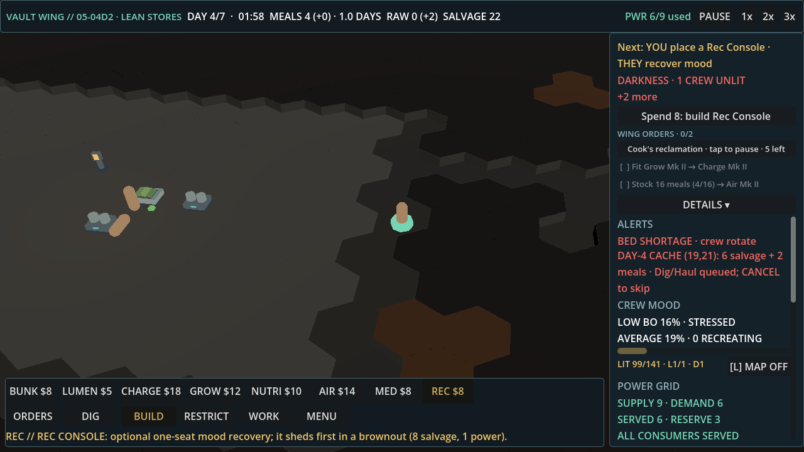
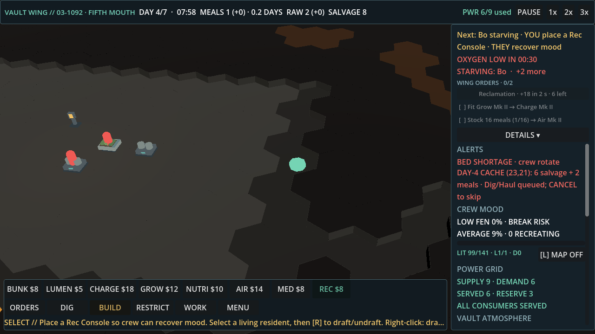
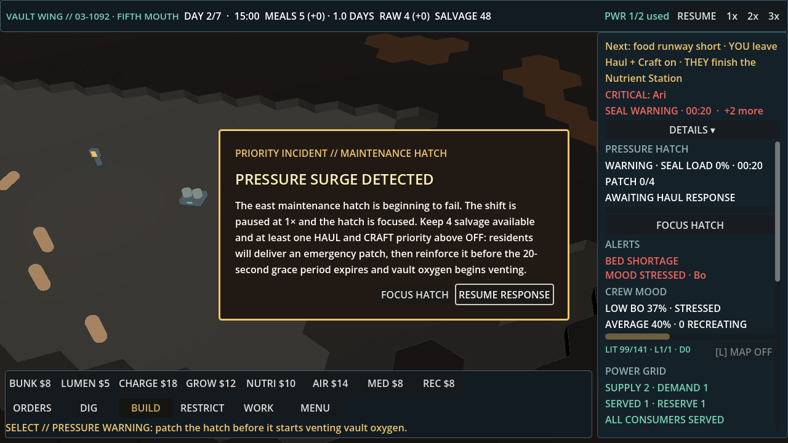

# Light-touch playtest 2: 03 s4242 and 05 s1234

Build: `feat/air-stall-balance` at df2e9ad7. Player: `tools/zz_scratch/zz_light.gd` (untracked). It follows Next or presses the Spend button only when the label has changed, at most once per 20 s of game time. There is no forced Spend press (`PT_FORCE=0`). The game runs at 30 fps fixed for 5200 frames, with a screenshot every 150 frames. Logs are in `vault-codex/light-touch-qa/lt2-03` and `lt2-05`.

## Outcomes

| Run | Outcome | Alive | Taps |
|---|---|---|---|
| 03 s4242 | WIN, sealed at 280 s | 5 of 5 (Ari, Bo, Cyra, Dax, Fen) | 7 Next, 1 Spend |
| 05 s1234 | WIN, sealed at 280 s | 4 of 4 (Ari, Bo, Cyra, Dax) | 4 Next, 4 Spend |

Both runs won with no deaths. Morale is what goes wrong. At the end of 05, every resident has mood between 9 and 16, and no Rec Console was ever built. In 03, Ari ends at mood 19.

## The 3 worst moments, ranked by quit risk

### 1. 05 s1234, 120.4 s: "Spend 8: build Rec Console" builds nothing

- **Tapped:** `Spend 8: build Rec Console`
- **Result:** the help line reads `REC // REC CONSOLE: optional one-seat mood recovery; it sheds first in a brownout (8 salvage, 1 power).` No blueprint is placed and no salvage is spent.
- **After:** `Next: YOU place a Rec Console · THEY recover mood` stays up from 143.3 s to the seal at 280 s, about 137 s. Crew mood falls to 9 to 16 (screenshot at 122.9 s: `LOW BO 16% · STRESSED`).
- **Same thing elsewhere:** `Spend 18: build Charge Node` at 80.2 s and 163.3 s did the same: the help line changed, nothing was built.
- **Why it's the worst:** the button says *build* and *Spend 8*, but it only arms the placement tool (`_on_upgrade_offer_pressed` → `set_tool`). The player did what the game said, saw nothing happen, and the problem it was meant to fix kept getting worse.
- **Suggested fix:** pressing Spend should place the blueprint at a valid floor cell next to the existing fixtures. The follow driver already finds such a cell. If manual placement stays, rename the button `Place Rec Console (8)…`, pulse the hover ghost, and change the help line to `Click free floor to place it`.

### 2. 03 s4242, 132.8 to 145.1 s: "starving", then "place a Rec Console"

- **On screen (133 s):** `Next: Bo starving · YOU place a Rec Console · THEY recover mood`, with `OXYGEN LOW IN 00:30`, `STARVING: Bo · +2 more`, and `MEALS 1` in the top bar.
- **Next flips:**
  - 125.1 s: `YOU place a Rec Console`
  - 132.8 s: `Bo starving · …`
  - 135.7 s: no prefix
  - 140.0 s: `Cyra starving · …`
- **Same thing later:** at 224.8 s, Next reads `Next: Dax starving · YOU place a Charge Node · THEY power the Rec Console`.
- **Why it hurts:** the game says a resident is starving, then gives an action about mood or power. A player who reads it will either distrust Next or feed the wrong system. The name flipping on and off makes it look broken.
- **Suggested fix:** only put the `<name> starving` prefix on a food action, such as `YOU leave Cook on`, a Nutrient Station, or a Grow Tray. Otherwise leave starving to the alert line. Also keep the prefix up for a few seconds once it appears, so it stops flickering.

### 3. 03 s4242, 64.7 to 81.5 s: Next flips between food and power, under the breach modal

- **On screen (67.5 s, behind `PRESSURE SURGE DETECTED`):** `Next: food runway short · YOU leave Haul + Craft on · THEY finish the Nutrient Station`
- **Next changed 5 times in about 17 s:**

| Time | Next |
|---|---|
| 64.7 s | `… place a Nutrient Station` |
| 64.7 s | `… leave Haul + Craft on · THEY finish the Nutrient Station` |
| 66.1 s | `… YOU place a Charge Node · THEY power the kitchen` |
| 69.4 s | `… finish the Nutrient Station` |
| 79.0 s | `… place a Charge Node` |
| 81.5 s | `… finish the Charge Node` |

- **Why it hurts:** the first breach is the most stressful moment of the run, with the game paused at 1× behind a modal. Next swaps between food and power, so the player never sees one stable instruction.
- **Suggested fix:** while the breach modal is up, freeze Next to the hatch response. After that, treat "finish the Nutrient Station" and "power the kitchen" as one step: `YOU place a Charge Node · THEY finish + power the kitchen`, so the power need doesn't keep replacing it.

## Not a quit risk (noted)

- 05 s1234 at 150 s: `OXYGEN LOW IN 00:53` keeps counting after the Air Recycler blueprint went in at 143.2 s. It is accurate, and the recycler finished in time.
- Both runs show `BED SHORTAGE · crew rotate` for most of the shift. It is harmless but always on.
