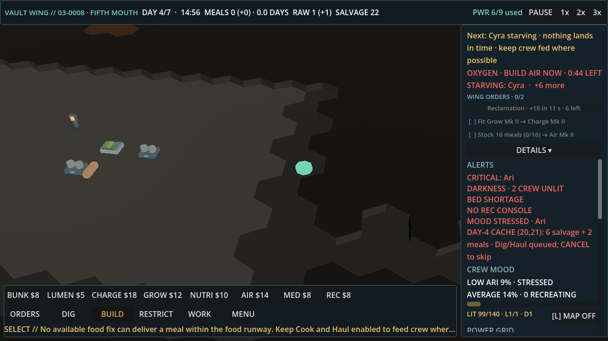
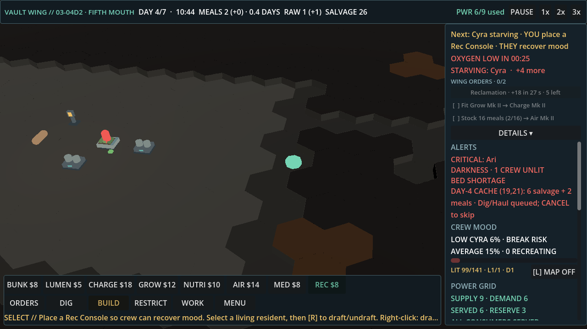
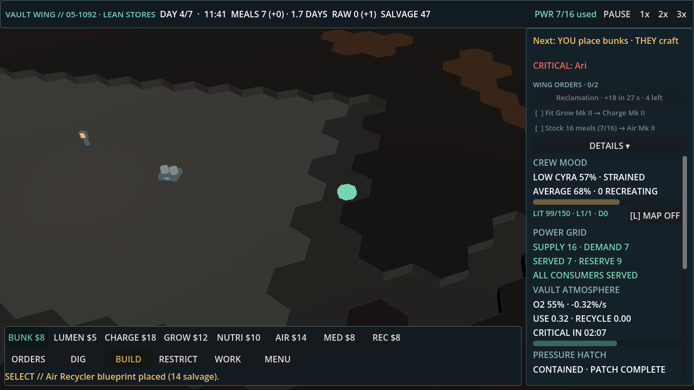

# Light-touch playtest 3: 03 s8, 03 s1234, and a busy player on 05 s4242

**Build:** `feat/rec-flash-cause` at 41ec5924. No game code was changed.

**Players** (both probes are untracked, in `tools/zz_scratch/`):
- **Light touch:** `zz_light3.gd`, which is `zz_light.gd` plus a mood log. It follows Next or presses Spend only when the label has changed, at most once per 20 s of game time. There is no forced Spend press (`PT_FORCE=0`).
- **Busy:** `zz_busy.gd`, a new probe. It follows every Next tip and presses Spend the moment either one appears or changes, with no rate limit.

**Setup:** 30 fps fixed for 5200 frames, idle mode. Moods are logged every 30 s. Logs are in `vault-codex/light-touch-qa/pt3-*`. The PNGs come from a second, exact-frame run (`pt3b-*`), whose Next log is identical to the first run's, so the game is deterministic here.

## Outcomes

| Run | Outcome | Alive | Final mood | Lowest mood in run | Taps |
|---|---|---|---|---|---|
| 03 s8, light | WIN, sealed at 280 s | 5 of 5 | Ari 28, Bo 18, Cyra 56, Dax 76, Fen 9 | Dax 0 (~180 s) | 10 Next, 1 Spend |
| 03 s1234, light | WIN, sealed at 280 s | 5 of 5 | Ari 40, Bo 53, Cyra 52, Dax 43, Fen 53 | Bo 5 (120 s) | 8 Next, 1 Spend |
| 05 s4242, busy | WIN, sealed at 280 s | 4 of 4 | Ari 56, Bo 66, Cyra 83, Dax 84 | 34 | 51 Next (25 acted on), 6 Spend |

All three runs won with no deaths.

The two light-touch 03 runs spend most of the middle game with crew mood below 20. The busy 05 player keeps mood at 34 or above.

No run ever placed bunks, so `BED SHORTAGE` stays up for most of each 03 run. That is partly a limit of the probe: the follow driver takes no action on `Next: YOU place bunks · THEY craft`. A real player could place them by hand.

## The 3 worst moments, ranked by quit risk

### 1. 03 s8, 144.7 s: "nothing lands in time"

**On screen:**
- Next: `Next: Cyra starving · nothing lands in time · keep crew fed where possible`
- Alert lines: `OXYGEN · BUILD AIR NOW · 0:44 LEFT` and `STARVING: Cyra · +6 more`
- Top bar: `MEALS 0 (+0) · 0.0 DAYS`
- Mood panel: `LOW ARI 9% · STRESSED`, `AVERAGE 14%`
- Help line: `No available food fix can deliver a meal within the food runway.`

**What happens:**
- The game tells the player that nothing they do will help, while a 44 s air deadline is running.
- The Air Recycler (`YOU spend 14: build Air Recycler`) was the real next action and was affordable (salvage 22).
- 1.9 s later, at 146.6 s, Next goes back to the Air step.
- The crew survived anyway, so the "nothing lands" message was also wrong about the outcome.

**Suggested fix:** when no food fix can land in time, don't let that hopeless line take over Next. Fall through to the next action that can still help, which here is Air with its countdown. Move the food message to the alert line as `STARVING: Cyra · no meal in time, keep Cook on`.

### 2. 03 s1234, 137.7 to 145.1 s: "starving · YOU place a Rec Console", with mood at 6%

**On screen (137.9 s):**
- Next: `Next: Cyra starving · YOU place a Rec Console · THEY recover mood`
- Alert lines: `OXYGEN LOW IN 00:25` and `STARVING: Cyra · +4 more`
- Mood panel: `LOW CYRA 6% · BREAK RISK`, `AVERAGE 15% · 0 RECREATING`
- Top bar: `MEALS 2`

**How Next flips:**

| Time | Next |
|---|---|
| 125.1 s | `YOU place a Rec Console · THEY recover mood` |
| 137.7 s | `Cyra starving · …` |
| 141.8 s | no name prefix |
| 142.4 s | `Dax starving · …` |

The same pairing shows up in 03 s8 at 203.2 s: `Next: Dax starving · YOU place a Rec Console · THEY recover mood`.

**Why it hurts:**
- In 03 s1234, mood had been collapsing since about 60 s: average 37 at 60 s, Bo at 5 by 120 s, Fen at 8 from 150 to 210 s.
- The Rec Console was only placed at 145 s.
- With a starving name in front of a mood action, the player can't tell which emergency comes first.
- This is the same problem as moment 2 in playtest 2. The Codex 6539075741 fix made the STARVING alert state-driven, but Next still puts the starving name in front of any action.

**Suggested fix:**
- Only put `<name> starving ·` on a food action: `leave Cook on`, a Nutrient Station, or a Grow Tray.
- Keep the prefix up for a few seconds once it appears, so it stops flickering.
- Offer the Rec Console when average mood first drops below about 40 (about 60 s here), not at 125 s.

### 3. 05 s4242 busy, 76.5 to 280 s: Next falls back to "place bunks" after every other action

**On screen (139.5 s, right after `Air Recycler blueprint placed (14 salvage)`):**
- Next: `Next: YOU place bunks · THEY craft`
- Alert line: `CRITICAL: Ari`
- Mood panel: `LOW CYRA 57% · STRAINED`

**The pattern:**
- After each action the busy player takes, Next switches back to `place bunks` within 1 to 2 s.
- This happened 8 times: at 76.5, 130.3, 139.3, 154.2, 168.4, 200.1, 228.4 and 258.4 s.
- Meanwhile the Spend button offers something else: `Grow Tray Mk II · 18 salvage`, `Charge Mk II · 18 · +3 power`, `Air Mk II · 18 salvage · -1 power`, and `Spend 12: build Grow Tray`.
- The bunk guard added in #144 only stops salvage-nudge offers, not Mk II fits or Grow Tray offers.

There was also a short flip-flop earlier, between 47.1 and 51.5 s. Next alternated `YOU leave Dig + Haul on · THEY build the Rec Console` and `food runway short · … THEY fund the Grow Tray` 5 times in 4 s.

**Why it hurts:** a player who does exactly what the game asks is sent back to bunks every time, and the Spend button disagrees with Next. The game feels like it is ignoring their choices.

**Suggested fix:**
- Apply the same bunk guard to the Mk II and Grow Tray offers, so Spend says the same thing as Next.
- Or, once a bunk step has been shown and passed over, let it give way to an affordable fit for a while before it comes back.
- Keep each Next step on screen for at least about 2 s, so steps can't flip several times within a few seconds.

## Dead time (30 s or more with nothing meaningful)

"Meaningful" here means a new Next step (ignoring countdown ticks and starving-name flips), a tap, a building added, or a phase change.

| Run | Window | Length | What is on screen |
|---|---|---|---|
| 03 s8 | 0.0 to 31.8 s | 32 s | `Next: YOU mark rock [E] · THEY dig on Dig defaults`. The crew digs on defaults and the player has nothing to do. |
| 03 s1234 | 0.0 to 31.8 s | 32 s | Same opening as 03 s8. |
| 03 s1234 | 205.4 to 262.3 s | 57 s | `Next: food runway short · YOU leave Cook on · THEY cook`, held after the Grow Tray Mk II fit. Moods recover on their own (Ari 76 and Dax 78 at 210 s), but the player only watches. |
| 05 s4242, busy | 76.5 to 114.0 s | 38 s | `Next: YOU place bunks · THEY craft`. The probe can't act on it, and nothing else is offered until the Grow Tray step at 114.0 s. |

There is one more stretch that isn't dead but is passive for a light-touch player. In 03 s8 from 125.1 to 165.2 s (40 s), `YOU spend 14: build Air Recycler` sat on screen through `BUILD AIR NOW` and into `LAST CHANCE · BUILD AIR IN 0:24` before the player tapped it.
