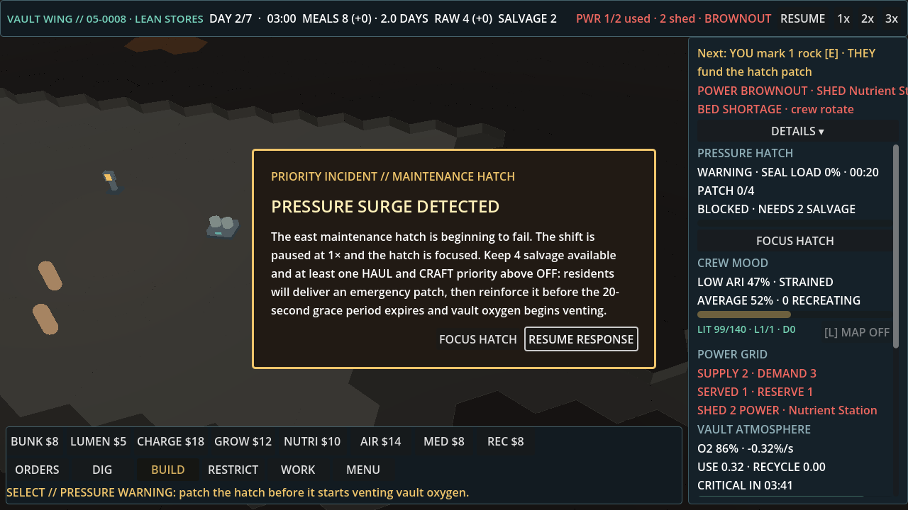
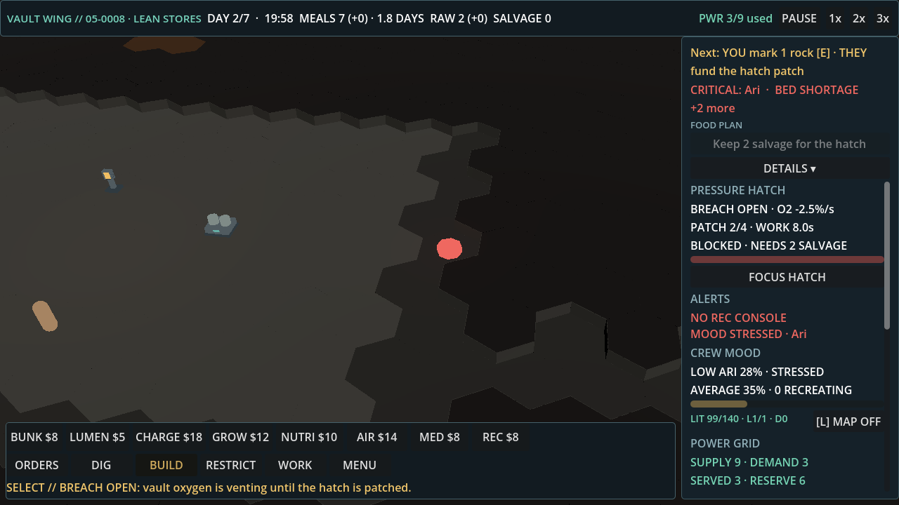
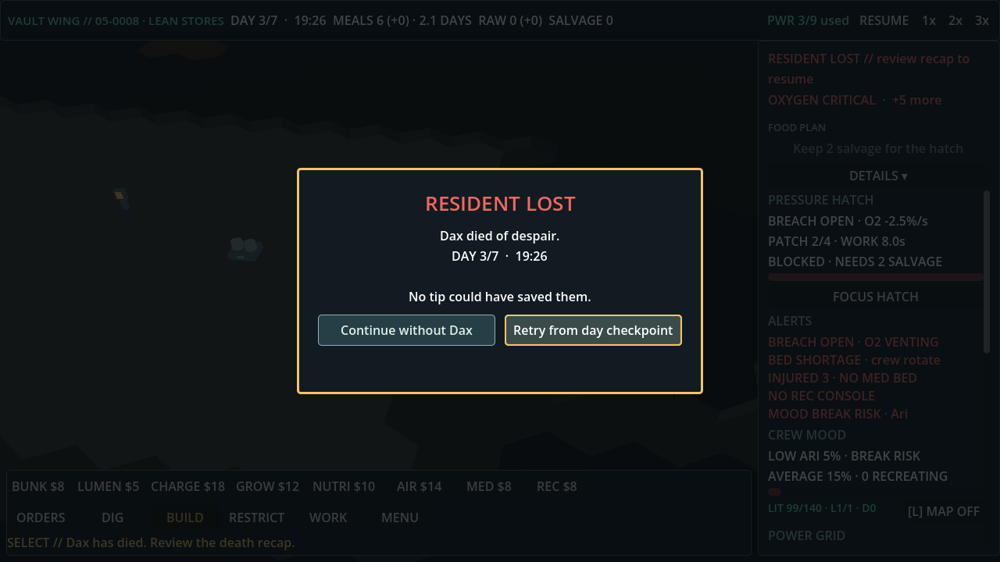

# QA: light-touch playtest, level 05 seed 8 (hand-written)

Build: `feat/alert-priority` @ 29b3b837 (PR #139). No game code was changed.

Driver: untracked `tools/zz_scratch/zz_light.gd`, which extends `tools/playtest/follow_driver.gd`. The player dismisses the briefing, plays at 2x and acknowledges the hatch modal after 75 frames. It follows Next, or presses Spend, only after that label changes, and at most once per 20 s of sim time. One extra Spend press is scheduled at 144 s. Godot 4.7.2 ran at 30 fps fixed, on display :14, one instance at a time.

## Result

Dax dies at **112.4 s**, on day 3. The player made only two taps:
- 23.6 s: Nutrient Station, 10 salvage
- 43.6 s: Charge Node, 18 salvage

The pressure warning starts at 45.0 s with 2 salvage left. The patch needs 4, so the breach opens at 65.0 s.

For comparison, the no-tap idle run seals the hatch at 58.7 s and lives until 280 s. **Following the tips leaves the player worse off than doing nothing.**

## Three worst player moments

1. **45.0 s: the hatch warning asks for salvage that Next just spent.** The modal says "Keep 4 salvage available", but salvage is 2. Both taps (Nutrient 23.6 s, Charge 43.6 s) followed "food runway short" tips. Neither tip warned that the hatch was coming, and a brownout sheds the Nutrient Station anyway.
   
2. **73 s: the breach is open and the fix is one rock away, but the player can't tell.** The panel shows "BREACH OPEN · O2 −2.5%/s · PATCH 2/4 · BLOCKED · NEEDS 2 SALVAGE". Next says "YOU mark 1 rock [E] · THEY fund the hatch patch", but the alert line leads with CRITICAL: Ari and BED SHORTAGE. O2 falls from 86 to 56 and the hatch stays open until the run ends.
   
3. **112.4 s: Dax is lost, and the recap says "No tip could have saved them."** He died of despair while the hatch was venting, about 70 s after the tips had spent the patch salvage. The recap contradicts what just happened to the player.
   

## Spend at about 144 s

The light-touch run had already ended at 112.4 s, so I ran this check separately. I used the same driver with no taps and pressed Spend at 144.1 s, when its label read "Spend 14: build Air Recycler". The status changed to "AIR RECYCLER: restores vault oxygen; build a Charge Node to supply its 3 power (14 salvage)." **There was no script error.** The captured stderr has only the V-Sync driver warning.

## Idle 05 (no taps) after the seal

After sealing at 58.7 s, idle 05 s8 never gets an Air Recycler, even though salvage reaches 121:
- O2 falls from 77 to 13 by 273 s.
- From 230 s, Next flips between "place Air Recycler" and "spend 8: build Rec Console" every 3 to 5 s.
- At 280 s the clock stops on "VICTORY PENDING // RESTORE O2 TO 15%" with O2 at 7.
- Ari and Bo die at 280.0 s.
